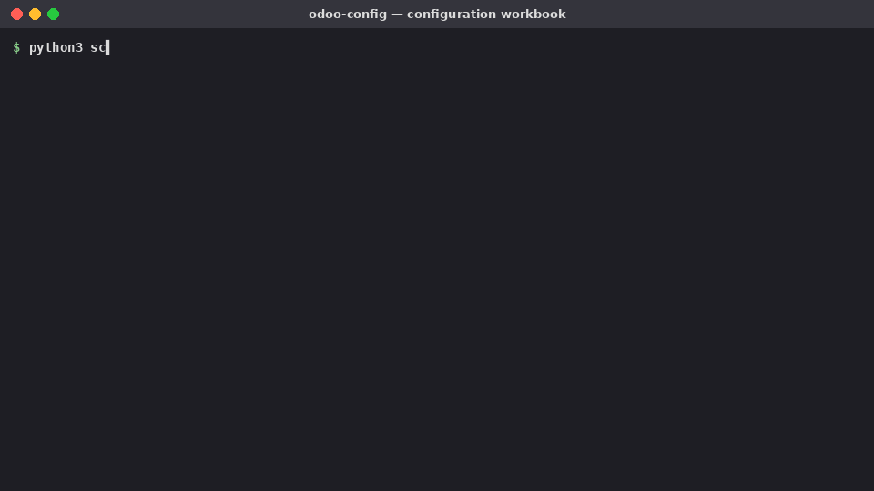

# odoo-config — Claude Skill for Odoo Functional Configuration (all versions)



Turns configuration into a signed decision log and checks the live database against it.

| Task | How |
|---|---|
| Configuration Workbook | `scripts/make_workbook.py` → Excel: settings per module (General, Accounting, Sales, Purchase, Inventory, MRP, POS, CRM) with options, recommendation, decision, owner, status dropdown; master sheets Taxes, Journals, Sequences, Warehouses, Approval Matrix, Roles; Sign-off |
| Thai accounting decisions | `references/th-accounting.md` (VAT 7%/0%/exempt, cash-basis VAT, withholding tax options, tax invoice, branch, numbering, currency rates) |
| Verify live database | `scripts/snapshot.py` (read-only XML-RPC) → Excel of companies, taxes, journals, payment terms, fiscal positions, currencies, warehouses, operation types, product categories, installed modules |

```bash
python3 .claude/skills/odoo-config/scripts/make_workbook.py Config_Workbook_v18.xlsx --version 18 --modules general,accounting,sales,purchase,inventory --project "Demo"
ODOO_URL=https://demo.odoo.com ODOO_DB=demo ODOO_USER=me@example.com ODOO_KEY=<api key> \
  python3 .claude/skills/odoo-config/scripts/snapshot.py Snapshot.xlsx
```
`snapshot.py` only calls `fields_get` and `search_read`; it never writes. Use an API key, not a password.

Status: workbook generation tested; `snapshot.py` tested against a mock XML-RPC server (missing models are skipped), not yet against a live Odoo instance. Setting names follow the Odoo 18 UI; verify on other versions.

## Installation

**claude.ai / Claude Desktop** — zip the `odoo-config` folder (the zip must contain `odoo-config/SKILL.md`), then Settings → Capabilities → Skills → Upload skill.

**Claude Code (all projects)**
```bash
git clone https://github.com/panusbodee-owen/odoo-config-skill.git
mkdir -p ~/.claude/skills
cp -r odoo-config-skill/.claude/skills/odoo-config ~/.claude/skills/
```
Requirements: `pip install openpyxl`.

## Related skills
[odoo-qa-docs](https://github.com/panusbodee-owen/odoo-qa-docs-skill) · [odoo-dev](https://github.com/panusbodee-owen/odoo-dev-skill) · [odoo-data-migration](https://github.com/panusbodee-owen/odoo-data-migration-skill) · [odoo-config](https://github.com/panusbodee-owen/odoo-config-skill) · [odoo-pm](https://github.com/panusbodee-owen/odoo-pm-skill)
